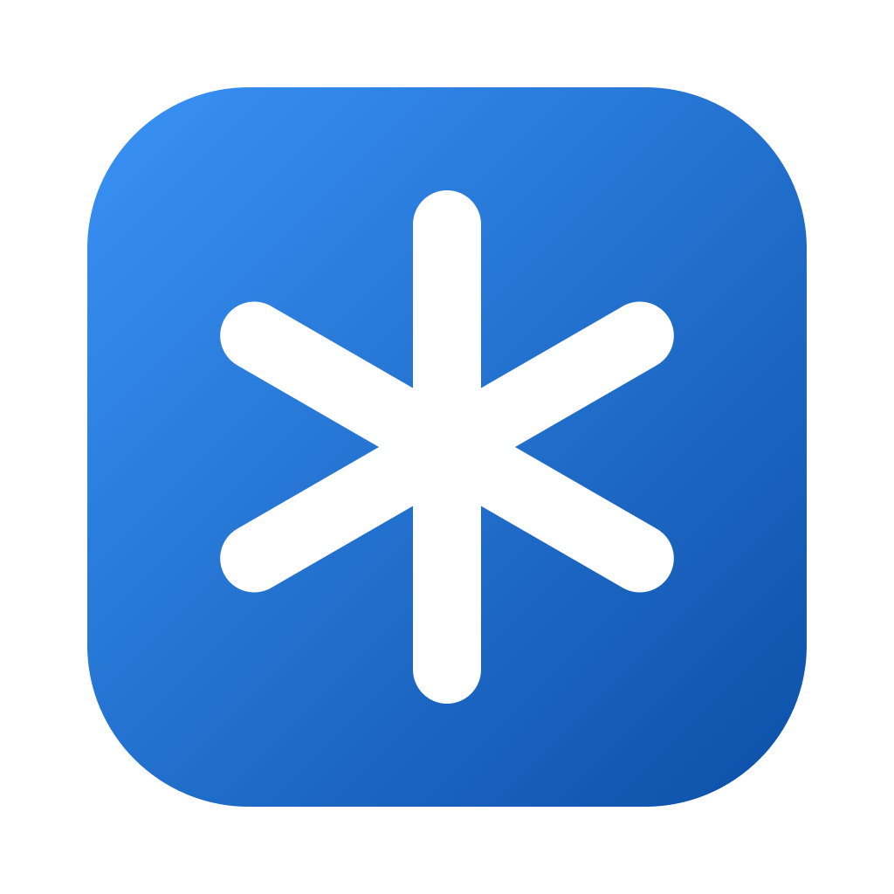

<p align="center">
  
</p>

<h1 align="center">Claude Manager</h1>

<p align="center">A desktop app for macOS, Windows and Linux that shows what your Claude Code sessions are doing right now: their subagents, background shells, tokens, cost and the devices they hold.</p>

---

## What it shows

- **Board.** One card per running Claude Code session, from the terminal, your IDE or the desktop app. Each card shows the current tool call or last message, running subagents and shells, held devices, the model, context and output tokens, and (optionally) an estimated cost. Cards re-sort as sessions change state.
- **Session view.** Click a card and it expands into the session:
  - **Tree:** the main thread, every subagent and every live shell.
  - **Timeline:** status over the last 15 minutes, 30 minutes or 2 hours, with a tick for each tool call.
  - **Inspector:** details for whatever you select: last message, recent tools, an agent's result, a shell's full command, CPU and memory.
- **All-sessions timeline.** Every session, including ones that ended recently, on one time axis.
- **Menu bar menu.** A native menu with counts, sessions waiting for you, every session (with its status and a submenu to open it or its timeline), devices, Settings and Quit. Closing the window keeps the app running there.
- **Notifications.** When a session is waiting for you, finishes a long turn, or leaves a shell running after it ends.

## What it can do

- **Kill a shell** a session started, including every process it spawned.
- **Kill orphaned shells** that kept running after their session ended.
- **Stop a session** (asks its Claude process to exit).
- **Rename and pin** sessions.

Every action asks for confirmation first.

## Install

Download the latest installer from [Releases](https://github.com/jakepurple13/claude-manager/releases):

| OS | Download |
|---|---|
| macOS (Apple Silicon or Intel) | `.dmg` |
| Windows | `.exe` (NSIS installer) |
| Linux | `.deb`, `.rpm` or `.AppImage` |

Installed copies update themselves: Claude Manager checks GitHub Releases at startup and every 6 hours (Settings › About), downloads only the changed parts when it can, verifies the SHA-512 and restarts into the new version.

> **macOS:** releases built without a Developer ID certificate are ad-hoc signed. The first time, right-click the app and choose **Open**.

## Settings

| Category | Options |
|---|---|
| Display | Theme (System, Light, Dark); show estimated cost |
| Notifications | Waiting for you; finished its turn (with a minimum turn length); shell outlived its session |
| History | Keep 1, 7 or 30 days; clear history |
| Data sources | Claude config folder; refresh interval (1, 2 or 5 s); Claude Device Manager status |
| About | Updates, version, database location |

**Estimated cost** is the API-equivalent price of each response (input, 5-minute and 1-hour cache writes, cache reads, output, including subagents), at Claude API list prices as of 2026-10-06. Subscription plans aren't billed per token, so treat it as a guide. It's off by default.

## How it works

Claude Manager only reads what Claude Code already writes; it needs no hooks or configuration.

| Data | Source |
|---|---|
| Live sessions | `~/.claude/sessions/<pid>.json` (watched for changes). The `.key` files and socket paths there are never read. |
| Activity, tokens, tools | Session transcripts, `~/.claude/projects/<project>/<session>.jsonl`, read incrementally |
| Subagents | `~/.claude/projects/<project>/<session>/subagents/agent-*.jsonl` and `.meta.json` |
| Shells | The process table: Claude Code's Bash shells source `~/.claude/shell-snapshots/…` and run `eval '<command>'` |
| Devices (optional) | Claude Device Manager's local daemon (`GET /cdm/list` on the port in `~/.claude-device-manager/port`), when it's installed and running |

`CLAUDE_CONFIG_DIR` is honored. These formats are not a documented Claude Code API, so a Claude Code update can change them; every reader skips anything it doesn't recognise rather than failing.

Claude Manager stores its own data (session names, pins, status history and settings) in a local database:

- macOS: `~/Library/Application Support/ClaudeManager`
- Windows: `%APPDATA%\ClaudeManager`
- Linux: `$XDG_DATA_HOME/claude-manager` (default `~/.local/share/claude-manager`)

## Build from source

Requirements: JDK 21 or later. Gradle is provided by the wrapper.

```shell
./gradlew :app:run                              # run the app
./gradlew :app:test                             # unit tests
./gradlew :app:packageDistributionForCurrentOS  # installers for this OS, in app/build/compose/binaries
```

Rebuilding replaces the jar a running copy loads classes from, so stop `:app:run` before running tests or packaging.

Notifications on macOS only appear from a packaged app; use `./gradlew :app:runDistributable` to try them.

## Releasing

Every push and pull request runs [`.github/workflows/build.yaml`](.github/workflows/build.yaml): `./gradlew build` (compile and unit tests) on Linux, macOS and Windows.

To publish a release, push a version tag:

```shell
git tag v1.2.0 && git push origin v1.2.0
```

[`.github/workflows/release.yaml`](.github/workflows/release.yaml) builds on Linux x64, Windows x64, macOS Apple Silicon and macOS Intel, generates the auto-update metadata (`latest-mac.yml`, `latest.yml`, `latest-linux.yml`) and publishes the GitHub Release. Tags like `v1.3.0-beta.1` publish a pre-release on the `beta` channel.

macOS signing and notarization run when these repository secrets are set: `MAC_CERTIFICATES_P12`, `MAC_CERTIFICATES_PASSWORD`, `MAC_DEVELOPER_ID_APPLICATION`, `MAC_NOTARIZATION_APPLE_ID`, `MAC_NOTARIZATION_PASSWORD`, `MAC_NOTARIZATION_TEAM_ID`.

## Tech stack

- [Compose Multiplatform](https://www.jetbrains.com/compose-multiplatform/) for the UI, Kotlin 2.4
- [Nucleus](https://nucleusframework.dev) for windows, the menu bar menu, notifications, file watching, packaging and auto-update
- [Navigation 3](https://developer.android.com/guide/navigation/navigation-3) with shared-element transitions
- AndroidX ViewModel
- [Koin](https://insert-koin.io) (DSL with the Koin Compiler Plugin)
- [Room 3](https://developer.android.com/jetpack/androidx/releases/room3) with the bundled SQLite driver

## Project layout

```
app/src/main/kotlin/com/programmersbox/claudemanager/
├── Main.kt                 entry point: window, menu bar menu, background services
├── data/
│   ├── registry/           live session registry
│   ├── transcript/         incremental transcript and subagent parsing
│   ├── process/            Claude shell detection and kill
│   ├── cdm/                Claude Device Manager client
│   ├── cost/               price table and cost estimates
│   ├── db/                 Room database, history
│   ├── settings/           settings storage
│   ├── notify/             notification rules
│   ├── update/             auto-update
│   ├── SessionRepository   one shared refresh for every screen
│   └── HistoryRecorder     records status changes for the timelines
├── di/                     Koin module
└── ui/                     board, session, timeline, settings, tray, theme, motion
```
